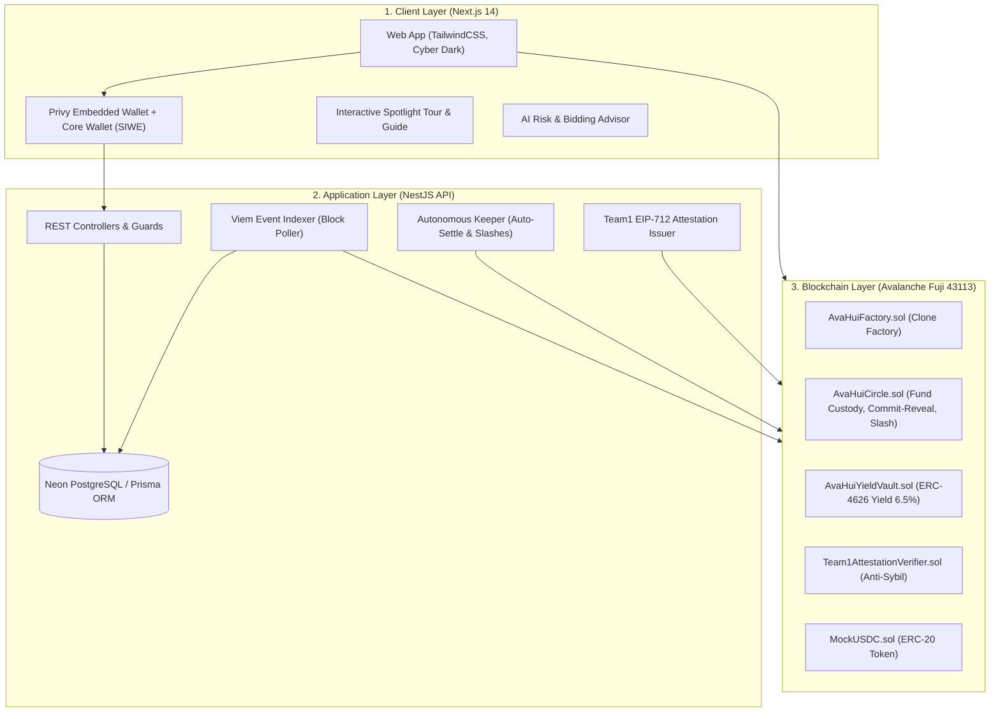

# AvaHui — Trustless On-Chain ROSCA (Hụi) Platform on Avalanche

[-E84142?logo=avalanche&logoColor=white)](https://testnet.snowtrace.io)
[](LICENSE)
[](https://nextjs.org)
[](https://nestjs.com)
[](https://soliditylang.org/)
[](#smart-contracts-đã-triển-khai-trên-avalanche-fuji)

> **AvaHui** là nền tảng Hụi On-Chain (ROSCA) phi lưu ký đầu tiên trên mạng Avalanche C-Chain, kết hợp bảo vệ **100% bằng tài sản thế chấp**, cơ chế **Đấu giá kín Sealed-Bid (Commit-Reveal)**, **Kho sinh lời tự động ERC-4626 Yield Vault** và **Xác thực danh tính chống gian lận đa ví Team1 Attestation**.  
> Được xây dựng và phát triển cho cuộc thi **AVALANCHE UNIHACK 2026** — *Topic 1: Social Finance (Hụi On-Chain).*

---

## Liên Kết Trực Tuyến (Live Deployments)

* **Web App (Vercel Live)**: [https://avahui-unihack-2026-web.vercel.app](https://avahui-unihack-2026-web.vercel.app)
* **Backend API (Render Live)**: [https://avahui-api.onrender.com/api/v1/health](https://avahui-api.onrender.com/api/v1/health)
* **API Swagger Documentation**: [https://avahui-api.onrender.com/api/docs](https://avahui-api.onrender.com/api/docs)
* **Kịch bản Video Demo 3 Phút**: [docs/VIDEO_DEMO_PLAN.md](./docs/VIDEO_DEMO_PLAN.md)
* **Tài liệu Kiến trúc Master Spec**: [docs/architecture/AVAHUI_MASTER_SPEC_AND_MOCK.md](./docs/architecture/AVAHUI_MASTER_SPEC_AND_MOCK.md)

---

## Bối Cảnh & Vấn Đề Thực Tiễn

Hụi (Họ, Biêu, Phường / ROSCA - Rotating Savings and Credit Association) là mô hình tài chính tương trợ cộng đồng quen thuộc của người Việt suốt hàng trăm năm, phục vụ hàng chục triệu người dân tích lũy và huy động vốn nhanh. Tuy nhiên, hụi truyền thống tồn tại **3 nỗi đau nhức nhối**:

1. **Rủi ro "Giựt Hụi" & Chủ hụi ôm quỹ bỏ trốn**: Quỹ chung được ủy thác hoàn toàn vào tay một cá nhân (Chủ hụi/Thảo hụi). Nếu chủ hụi vỡ nợ hoặc lạm dụng vốn, toàn bộ người chơi mất trắng.
2. **Thành viên nhận sớm rồi bùng kỳ sau (Default Risk)**: Thành viên sau khi "hốt hụi" ở các vòng đầu có thể biến mất hoặc mất khả năng thanh toán các vòng sau, gây đổ vỡ dây chuyền cho người hốt sau.
3. **Bất minh bạch trong đấu giá (Lộ giá bỏ thăm)**: Thăm giấy truyền thống dễ bị thông đồng, đổi thăm, lộ mức chiết khấu, tước đoạt quyền lợi của người cần vốn chính đáng.

---

## Giải Pháp Của AvaHui

AvaHui giải quyết triệt để các vấn đề trên bằng công nghệ Blockchain và Hợp đồng thông minh trên Avalanche:

* **Smart Contract thay thế Chủ Hụi (Non-Custodial)**: Không một cá nhân nào có quyền giữ hay rút trộm quỹ chung. Toàn bộ tiền cọc và tiền đóng góp được khóa an toàn trong Smart Contract và chỉ giải ngân theo thuật toán định sẵn.
* **Bảo vệ 100% bằng Tài Sản Thế Chấp (Collateral Multiplier)**: Mọi thành viên phải khóa tài sản thế chấp (`mUSDC`) trước khi dây hụi kích hoạt (`ACTIVE`).
* **Tự Động Trích Cọc Bù Quỹ (Auto-Slash Penalty)**: Nếu thành viên đóng trễ hạn (vượt quá `gracePeriod`), Smart Contract sẽ tự động kích hoạt phạt cọc, trích trực tiếp tài sản thế chấp để bù đắp đủ 100% quỹ cho người nhận hụi của kỳ đó.
* **Đấu Giá Kín 2 Pha (Sealed-Bid Commit-Reveal)**: 
  * *Pha 1 (Commit)*: Người chơi gửi mã băm `keccak256(bidAmount, salt)` lên mạng, đảm bảo không ai có thể nhìn lén giá đấu của nhau.
  * *Pha 2 (Reveal)*: Mở niêm phong công khai, minh bạch tuyệt đối, tự động phân định người thắng (chiết khấu cao nhất) và chia đều phần tiền chiết khấu cho các thành viên còn lại.
* **Kho Sinh Lời Tự Động (ERC-4626 Yield Vault)**: Lượng tiền thế chấp nhàn rỗi trong suốt chu kỳ dây hụi được kết nối vào `AvaHuiYieldVault` chuẩn ERC-4626, tự động sinh lãi suất (`6.5% APY`), tối ưu hóa hiệu quả sử dụng vốn của người tham gia.
* **Chống Gian Lận Đa Ví (Team1 Anti-Sybil Attestation)**: Tích hợp chữ ký xác thực EIP-712 và Nullifier `1-Human-1-Slot`, đảm bảo một người thật chỉ được chiếm tối đa một suất trong mỗi dây hụi.
* **Trải Nghiệm Hybrid Web2 × Web3**: Hỗ trợ đăng nhập tiện lợi qua Google / Email với **Ví nhúng Privy tự động** cho người dùng mới, song song với **Core Wallet / MetaMask (SIWE)** cho người dùng Web3.
* **Tuân Thủ Pháp Lý Việt Nam**: Thiết kế bám sát **Nghị định 19/2019/NĐ-CP** về họ, hụi, biêu, phường (tính chất tương trợ phi thương mại, khống chế trần lãi suất $\le 20\%$/năm theo Điều 468 Bộ luật Dân sự 2015).

---

## Tại Sao Lại Là Avalanche?

| Ưu thế của Avalanche | Giá trị mang lại cho AvaHui |
| :--- | :--- |
| **Tốc độ chốt khối Sub-Second (< 2s)** | Mọi thao tác đóng tiền, nộp giá đấu kín và tất toán vòng diễn ra tức thì, mang lại trải nghiệm mượt mà như ứng dụng Web2. |
| **Phí Gas siêu rẻ (< $0.01)** | Nhóm 5–20 người đóng tiền định kỳ hàng tuần/hàng tháng không bị hao hụt quỹ chung vì chi phí giao dịch mạng. |
| **USDC Native trên C-Chain** | Thanh khoản đồng USD chuẩn thể chế, loại bỏ hoàn toàn rủi ro biến động giá tiền mã hóa trong quá trình chơi hụi. |
| **Kiến trúc L1 / Subnet** | Sẵn sàng mở rộng thành App-Chain / Avalanche L1 riêng biệt cho mạng lưới tài chính vi mô toàn quốc trong tương lai. |

---

## Kiến Trúc Hệ Thống (System Architecture)



---

## Smart Contracts Đã Triển Khai Trên Avalanche Fuji

Mạng thử nghiệm: **Avalanche Fuji Testnet** (`Chain ID: 43113`, `RPC: https://avalanche-fuji-c-chain-rpc.publicnode.com`)

| Hợp Đồng Thông Minh | Địa Chỉ Contract (Fuji C-Chain) | Mô Tả Chức Năng |
| :--- | :--- | :--- |
| **AvaHuiFactory** | [`0x15846dfb15738c373def01154ea9bd4b0bc685b5`](https://testnet.snowtrace.io/address/0x15846dfb15738c373def01154ea9bd4b0bc685b5) | Nhà máy tạo dây hụi (EIP-1167 Minimal Proxy Clone), tiết kiệm gas tối đa. |
| **AvaHuiYieldVault** | [`0xb677606338081517831e478317660b8b961e2596`](https://testnet.snowtrace.io/address/0xb677606338081517831e478317660b8b961e2596) | Kho sinh lời chuẩn ERC-4626 (`6.5% APY`) đầu tư phần tiền cọc nhàn rỗi. |
| **Team1AttestationVerifier** | [`0xccd16a62cd25b5d1744acb35a14b1c7bd65bfa78`](https://testnet.snowtrace.io/address/0xccd16a62cd25b5d1744acb35a14b1c7bd65bfa78) | Bộ xác thực chữ ký EIP-712 và Nullifier chống tài khoản ảo/nhiều ví. |
| **MockUSDC** | [`0x6a69e4639dcf39fec756dcea4b633137d63bbe9f`](https://testnet.snowtrace.io/address/0x6a69e4639dcf39fec756dcea4b633137d63bbe9f) | Stablecoin thử nghiệm (6 decimals) tích hợp sẵn Faucet `+1,000 mUSDC`. |
| **Genesis Live Circle #1** | [`0x81e8062cc39e6154cc029bd96ae0f3b72437755a`](https://testnet.snowtrace.io/address/0x81e8062cc39e6154cc029bd96ae0f3b72437755a) | Dây hụi mẫu đang hoạt động trực tiếp trên mạng Avalanche Fuji. |

---

## Cấu Trúc Monorepo (Package-by-Feature)

Dự án sử dụng mô hình Monorepo tiêu chuẩn cao với `pnpm workspace`:

```text
avahui-unihack-2026/
├── apps/
│   ├── web/                        # Ứng dụng Frontend (Next.js 14 App Router)
│   │   ├── src/app/                # Trang giao diện: /, /dashboard, /circles, /profile, /admin, /guide
│   │   ├── src/components/         # Layout (TopNavbar, AppSidebar, CyberLoading), Auth, UI
│   │   ├── src/features/           # Feature Modules (circles, contributions, bidding, guide, admin)
│   │   ├── src/hooks/              # Custom Hooks (useAvaHuiMockQuery, useCircleActions, useTokenOperations)
│   │   └── src/lib/                # API client, Privy Bridge, Wagmi/Viem Client
│   │
│   ├── api/                        # Ứng dụng Backend API & Event Indexer (NestJS 10)
│   │   ├── prisma/                 # Schema cơ sở dữ liệu PostgreSQL & Migrations
│   │   └── src/modules/            # Modular Modules:
│   │       ├── blockchain/         # Event Indexer (Viem) & Autonomous Keeper Service
│   │       ├── circles/            # Quản lý vòng hụi, thành viên, đóng góp, đấu giá
│   │       ├── verifiers/          # Team1 Attestation EIP-712 Signing Service
│   │       ├── auth/               # Xác thực Privy JWT & SIWE EIP-4361
│   │       └── ai/                 # Trợ lý AI Advisor (Google Gemini / Heuristics)
│   │
│   └── contracts/                  # Smart Contracts Solidity 0.8.38 & Foundry
│       ├── src/                    # AvaHuiFactory.sol, AvaHuiCircle.sol, AvaHuiYieldVault.sol
│       ├── test/                   # Unit test, Fuzz test, Invariant test
│       └── script/                 # Script triển khai DeployFuji.s.sol
│
├── packages/
│   ├── shared/                     # Types, Enums, DTOs, Constants dùng chung
│   ├── blockchain/                 # ABIs TypeScript, Chain Definitions, Contract Addresses
│   └── config/                     # Shared ESLint, Prettier & TSConfig
│
├── docs/                           # Tài liệu chi tiết:
│   ├── VIDEO_DEMO_PLAN.md          # Kịch bản chi tiết quay Video Demo 3 phút
│   └── architecture/               # Bảng đặc tả kiến trúc Master Spec & Business Rules
│
├── docker-compose.yml              # Cấu hình khởi chạy Docker PostgreSQL & Fullstack
└── package.json                    # Workspace Scripts quản lý toàn bộ hệ thống
```

---

## Hướng Dẫn Cài Đặt & Khởi Chạy Local (Getting Started)

### 1. Yêu cầu môi trường
* **Node.js**: Phiên bản `>= 20.0.0`
* **pnpm**: Phiên bản `>= 9.0.0` (`npm i -g pnpm`)
* **Docker Desktop**: Dùng cho PostgreSQL cục bộ

### 2. Cài đặt Dependencies
```bash
# Clone repository
git clone https://github.com/QCuong-SW/avahui-unihack-2026.git
cd avahui-unihack-2026

# Cài đặt toàn bộ thư viện trong monorepo
pnpm install
```

### 3. Cấu hình biến môi trường (`.env`)
Dự án đã chuẩn bị sẵn các file mẫu:
```bash
# 1. Biến môi trường cấp Root & Docker
cp .env.example .env

# 2. Biến môi trường Backend API
cp apps/api/.env.example apps/api/.env

# 3. Biến môi trường Frontend Web
cp apps/web/.env.example apps/web/.env.local
```

### 4. Khởi chạy Database cục bộ & Chạy Migration
```bash
# Bật container PostgreSQL
pnpm db:up

# Chạy Prisma migration và seed dữ liệu ban đầu
pnpm --filter @avahui/api prisma migrate deploy
pnpm db:reset-seed
```

### 5. Khởi chạy Ứng dụng ở chế độ Phát triển (Development)

Mở 2 cửa sổ terminal riêng biệt:

* **Terminal 1: Khởi chạy Backend API & Event Indexer (Port 3001)**:
  ```bash
  pnpm dev:api
  ```
  * Swagger Docs: [http://localhost:3001/api/docs](http://localhost:3001/api/docs)
  * Health Check: [http://localhost:3001/api/v1/health](http://localhost:3001/api/v1/health)

* **Terminal 2: Khởi chạy Frontend Web (Port 3000)**:
  ```bash
  pnpm dev:web
  ```
  * Truy cập ứng dụng: [http://localhost:3000](http://localhost:3000)

---

## Khởi Chạy Toàn Bộ Hệ Thống Bằng Docker

Bạn có thể đóng gói và khởi chạy toàn bộ hệ thống (PostgreSQL + NestJS API + Next.js Web) chỉ với một lệnh duy nhất:
```bash
# Build & chạy toàn bộ dịch vụ trong nền
pnpm docker:deploy

# Tắt toàn bộ dịch vụ
pnpm docker:down
```

---

## Kiểm Thử Hệ Thống (Testing & Verification)

AvaHui được kiểm thử nghiêm ngặt ở tất cả các tầng công nghệ:

### 1. Kiểm thử Backend & Logic Nghiệp Vụ (Jest)
```bash
pnpm --filter @avahui/api test
```
* **Kết quả**: `5/5 Test Suites passed`, `28/28 Tests passed (100%)`.
* Bao gồm: Luồng trọn vẹn vòng đời hụi (`e2e-lifecycle`), Bảo mật phân quyền (`stage2-security`), Đấu giá kín & Cọc (`business-b2`), CORS & Rate limiting.

### 2. Kiểm thử Biên dịch & Kiểm tra Kiểu Frontend
```bash
# Kiểm tra TypeScript type-check
pnpm --filter @avahui/web type-check

# Build thử nghiệm Next.js Production
pnpm build:web
```
* **Kết quả**: `15/15` trang tĩnh và động được tạo thành công không lỗi cú pháp.

---

## Tuyên Bố Miễn Trừ Pháp Lý (Legal Disclaimer)

1. **Mục đích Thử nghiệm Công nghệ**: Nền tảng AvaHui được phát triển trong khuôn khổ cuộc thi học thuật **Avalanche UniHack 2026** nhằm chứng minh tính khả thi của hợp đồng thông minh trong việc giải quyết rủi ro tài chính cộng đồng.
2. **Môi trường Testnet**: Mọi giao dịch hiện tại sử dụng token thử nghiệm `mUSDC` và `AVAX` trên mạng **Avalanche Fuji Testnet** (`Chain ID: 43113`), không có giá trị quy đổi thành tiền pháp định và không cấu thành dịch vụ tài chính hay cho vay thương mại.
3. **Định hướng Pháp luật Việt Nam**: Giao thức tham chiếu các nguyên tắc của **Nghị định 19/2019/NĐ-CP** (Họ, Hụi, Biêu, Phường nhằm mục đích tương trợ phi thương mại) và kiểm soát trần chiết khấu không vượt quá **20%/năm** theo quy định tại Điều 468 Bộ luật Dân sự 2015.

---

## Đội Ngũ Phát Triển (Team)

Dự án được xây dựng bởi đội ngũ sinh viên đam mê công nghệ Web3 tham gia **Avalanche UniHack 2026**:
* **Smart Contracts & Security**: Thiết kế kiến trúc Factory, Vault ERC-4626, Logic Commit-Reveal & Auto-Slash.
* **Backend & Blockchain Indexing**: NestJS, Event Indexer Viem, Autonomous Keeper & Team1 Verifier.
* **Frontend & UX Design**: Next.js 14, TailwindCSS, Cyber-Fintech Design System, Spotlight Tour & Privy Integration.

---

*© 2026 AvaHui Team. Released under the [MIT License](LICENSE).*
