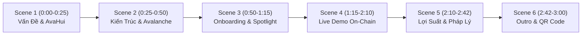

# Kế Hoạch & Kịch Bản Chi Tiết Quay Video Demo AvaHui V2 (3 Phút Chuẩn Hackathon)

> **Dự án**: AvaHui — Hụi On-Chain Minh Bạch trên Avalanche  
> **Chủ đề**: Topic 1: Social Finance — Hụi On-Chain (ROSCA)  
> **Mục tiêu**: Video Demo 3 phút thuyết phục hoàn toàn Ban giám khảo về tính khả thi, độ hoàn thiện On-Chain thật, UX không rào cản và giải quyết triệt để vấn đề "Giựt Hụi".  
> **Đường dẫn Live Web App**: [https://avahui-unihack-2026-web.vercel.app](https://avahui-unihack-2026-web.vercel.app)  
> **Backend API Live**: [https://avahui-api.onrender.com/api/v1/health](https://avahui-api.onrender.com/api/v1/health)  

---

## 1. Chuẩn Kỹ Thuật & Dựng Phim (Post-Production Specs)

* **Thời lượng tối ưu**: `03:00` (Đúng chuẩn giới hạn video của các cuộc thi Hackathon Web3).
* **Độ phân giải & Khung hình**: `1920 × 1080 Full HD (60fps)` hoặc `4K (60fps)`, xuất chuẩn `MP4 H.264`.
* **Phần mềm quay đề xuất**: 
  * **Screen Studio** (khuyên dùng): Tự động phóng to (auto-zoom) mượt mà theo trỏ chuột, bo góc cửa sổ macOS và tạo nền gradient cao cấp.
  * **OBS Studio**: Quay màn hình tĩnh với độ trễ thấp nếu muốn tùy biến layout.
* **Công cụ dựng & chèn phụ đề**: **CapCut Pro** / **Adobe Premiere** / **DaVinci Resolve** (sử dụng tính năng Auto-Captions để tự sinh phụ đề tiếng Việt / tiếng Anh sắc nét).
* **Bảng màu đồ họa thương hiệu (Color Palette)**:
  * Nền tối chủ đạo: `#09090B` (Zinc-950)
  * Đỏ thương hiệu Avalanche: `#E84142` (Avalanche Red)
  * Xanh ngọc thành công / Lợi suất: `#10B981` (Emerald Green)
  * Vàng cảnh báo / Đấu giá: `#F59E0B` (Amber)
  * Font chữ tiêu đề & số liệu: `JetBrains Mono` / `Space Grotesk` (In hoa, sắc cạnh, phong cách Cyber-Fintech).
* **Cấu trúc âm thanh (3 Layers)**:
  1. **Voiceover**: Giọng đọc truyền cảm, rõ chữ, tốc độ khoảng 130–140 từ/phút.
  2. **Background Music (BGM)**: Nhạc Modern Cyber/Fintech Minimalist (âm lượng `-20dB` khi có lời đọc, `-10dB` lúc mở đầu và kết thúc).
  3. **Sound Effects (SFX)**:
     * *Glass Whoosh*: Chuyển cảnh giữa các phân đoạn.
     * *Crisp UI Click*: Khi bấm các nút thao tác chính.
     * *Digital Lock*: Khi bấm "Niêm phong giá đấu (Commit Bid)" hoặc "Khóa thế chấp".
     * *Coin Shimmer / Success Chime*: Khi nhận giải ngân quỹ hoặc hoàn tất giao dịch trên Snowtrace.

---

## 2. Bảng Phân Cảnh Chi Tiết (Shot-by-Shot Timeline: 0:00 – 3:00)

---

### SCENE 1 (0:00 – 0:25) — HOOK: Nỗi Đau Hụi Truyền Thống → Giải Pháp AvaHui

* **Bố cục hình ảnh**:
  * `0:00 – 0:08`: Chia đôi màn hình (**Split-Screen**):
    * Bên trái: Tờ giấy ghi sổ hụi tay cũ kỹ, mờ tối kèm tiêu đề đỏ cảnh báo: *"Bùng hụi • Chủ hụi ôm tiền • Lộ thông tin"*.
    * Bên phải: Trang chủ **AvaHui** (`https://avahui-unihack-2026-web.vercel.app`) trượt lên sắc nét với hiệu ứng Cyber Dark Mode.
  * `0:08 – 0:25`: Zoom vào phần **Showcase tương tác** và Ma trận so sánh: *Hụi Truyền Thống vs AvaHui On-Chain*.
* **Text Overlay (Chữ trên màn hình)**:
  * `HỤI TRUYỀN THỐNG: ĐẶT NIỀM TIN VÀO CÁ NHÂN` ➔ `AVAHUI: ĐẶT NIỀM TIN VÀO SMART CONTRACT`
* **Lời đọc (Voiceover)**:
  > *"Ở Việt Nam, hụi là hình thức tiết kiệm và huy động vốn cộng đồng quen thuộc suốt hàng trăm năm. Nhưng chỉ cần chủ hụi vỡ nợ hoặc một thành viên nhận sớm rồi bùng kỳ sau, cả dây hụi lập tức sụp đổ. Đó là lý do chúng tôi xây dựng **AvaHui**: đưa toàn bộ nghiệp vụ hụi xoay vòng lên Smart Contract trên Avalanche — nơi không cá nhân nào giữ tiền chung, mọi dòng tiền đều minh bạch và bảo vệ 100% bằng tài sản thế chấp."*
* **SFX**: Tiếng *Low Bass Boom* lúc hiện nỗi đau ➔ *Riser Whoosh* chuyển sang giao diện sắc nét của AvaHui.

---

### SCENE 2 (0:25 – 0:50) — TẠI SAO LÀ ON-CHAIN? TẠI SAO LÀ AVALANCHE?

* **Bố cục hình ảnh**:
  * `0:25 – 0:38`: Đồ họa sơ đồ kiến trúc 3 lớp:
    * `Người dùng (Core Wallet / Privy)` ➔ `AvaHuiFactory` (Tạo dây) ➔ `AvaHuiCircle` (Giữ quỹ, đấu giá kín, Auto-Slash) + `AvaHuiYieldVault (6.5% APY)` + `Team1AttestationVerifier`.
  * `0:38 – 0:50`: Lướt qua thanh trạng thái mạng **Avalanche Fuji (43113)** với 2 thông số vàng: **Tốc độ chốt < 2 giây** và **Phí gas < $0.01**.
* **Text Overlay (Callout 2 câu hỏi cốt lõi)**:
  * `WHY ON-CHAIN?` ➔ *Hợp đồng thông minh thay thế chủ hụi: Tiền nằm trong Vault, tự động đền bù thế chấp khi trễ hạn.*
  * `WHY AVALANCHE?` ➔ *Finality ~2s • Phí cực thấp cho chu kỳ đóng hàng tuần • USDC native trên C-Chain.*
* **Lời đọc (Voiceover)**:
  > *"Vì sao giải pháp này bắt buộc phải On-Chain? Vì Smart Contract đóng vai trò thủ quỹ tự động bất biến: không ai có quyền ôm quỹ chạy trốn, và thành viên vi phạm sẽ tự động bị phạt hợp đồng. Và vì sao lại là **Avalanche**? Nhóm 10 đến 20 người đóng định kỳ hàng tuần cần tốc độ xử lý nhanh dưới 2 giây và phí mạng siêu rẻ để quỹ không bị hao hụt, đồng thời tận dụng thanh khoản USDC gốc trên C-Chain."*
* **SFX**: *Tech blip* nhẹ nhàng xuất hiện theo từng khối của sơ đồ.

---

### SCENE 3 (0:50 – 1:15) — ONBOARDING KHÔNG RÀO CẢN & HƯỚNG DẪN TƯƠNG TÁC SPOTLIGHT

* **Bố cục hình ảnh**:
  * `0:50 – 1:02`: Màn hình đăng nhập `/login`:
    * Di chuột qua 2 lựa chọn: **Đăng nhập Google / Email** (tự sinh ví nhúng Privy không cần nhớ 12 từ khóa) và **Kết nối Ví Core / MetaMask** (ký SIWE bảo mật không tốn gas).
  * `1:02 – 1:15`: Vào `/dashboard` ➔ Hộp thoại **"Bạn có phải người mới sử dụng không?"** ➔ Bấm **Bắt đầu hướng dẫn**:
    * Chế độ **Interactive Spotlight** khoanh đỏ nổi bật từng vùng (Thanh tiện ích, Faucet nhận vốn, Thống kê tài sản). Thao tác nhận ngay `+1,000 mUSDC` và `+0.02 AVAX` gas mượt mà.
* **Text Overlay**:
  * `WEB2 UX × WEB3 SECURITY`
  * `Spotlight Tour: Trải nghiệm tập luyện trực tiếp trên UI thật`
* **Lời đọc (Voiceover)**:
  > *"Để bất kỳ ai cũng có thể tiếp cận, AvaHui hỗ trợ người dùng phổ thông đăng nhập bằng Google hoặc Email với ví nhúng tự động, bên cạnh việc kết nối ví Web3 Core Wallet cho người dùng chuyên nghiệp. Ngay lần đầu truy cập, tính năng **Interactive Spotlight Tour** sẽ hướng dẫn từng bước trực tiếp trên giao diện thực tế — từ nhận vốn thử nghiệm, đặt cọc cho đến đấu giá kín — đảm bảo người dùng hiểu rõ cuộc chơi trước khi bắt đầu."*
* **SFX**: *UI pop* và tiếng *chime* khi hoàn thành bước hướng dẫn.

---

### SCENE 4 (1:15 – 2:10) — LIVE DEMO ON-CHAIN: MỞ DÂY, ĐẤU GIÁ KÍN & AUTO-SLASH

*(Phân đoạn đắt giá nhất chứng minh toàn bộ tính năng MVP và 4 điểm Bonus hoạt động thật 100%)*

* **Bố cục hình ảnh (Zoom 1.4x vào từng thao tác)**:
  * `1:15 – 1:28` (**Khởi tạo dây hụi**):
    * Vào `/circles/create`, chuyển đổi linh hoạt giữa 2 chế độ: **Đấu giá chiết khấu** và **Thứ tự cố định**.
    * Bật các tùy chọn bảo mật V2: *Đấu giá kín 2 pha*, *Kho sinh lời ERC-4626 (6.5% APY)*, *Xác thực Team1 (1 người / 1 suất)*, *Mã mời riêng tư*.
    * Bấm nút mở dây, hiển thị modal ký giao dịch rõ ràng.
  * `1:28 – 1:50` (**Đóng hụi & Đấu giá kín Sealed-Bid**):
    * Mở một dây hụi đang chạy: Bấm nút **Đóng kỳ 50.00 mUSDC** ➔ Modal 4 bước thực thi on-chain.
    * Vào pha đấu giá: Nhập mức chiết khấu muốn nhường ➔ Bảng tự động tính *Số tiền thực nhận dự kiến*.
    * Bấm **Niêm phong giá (Commit)**: Mã hóa `keccak256(bid, salt)` ➔ Tải file sao lưu Salt JSON an toàn ➔ Bấm **Mở niêm phong (Reveal)** khi hết giờ.
  * `1:50 – 2:10` (**Cơ chế Auto-Slash bảo vệ quỹ**):
    * Chuyển sang tab **Thành viên & Lịch sử**: Chỉ vào thành viên chậm đóng bị hợp đồng kích hoạt **Đã trích thế chấp (Auto-Slash)** bù đủ 100% quỹ cho người thắng kỳ.
    * Bấm vào liên kết Tx Hash ➔ Mở trực tiếp trang **Snowtrace Fuji Explorer** chứng minh giao dịch on-chain thành công.
* **Text Overlay (Huy hiệu 4 tính năng Bonus)**:
  * `✓ MÃ MỜI RIÊNG TƯ (INVITE CODE)`
  * `✓ CHỐNG SYBIL TEAM1 (1 HUMAN 1 SLOT)`
  * `✓ ĐẤU GIÁ KÍN COMMIT-REVEAL (CHỐNG LỘ THĂM)`
  * `✓ AUTO-SLASH TRÍCH CỌC TỰ ĐỘNG BÙ QUỸ`
* **Lời đọc (Voiceover)**:
  > *"Đi vào luồng giao dịch thật trên Avalanche Fuji: Khi mở dây, bạn có thể thiết lập mức đóng, chu kỳ và bật đầy đủ cơ chế bảo vệ như mã mời riêng tư và **chứng thực Team1 chống gian lận đa ví**. Ở mỗi kỳ, thành viên đóng góp vào quỹ chung. Khi đấu giá nhận hụi sớm, AvaHui áp dụng cơ chế **Sealed-Bid 2 pha**: pha đầu mã hóa giá đấu kèm chuỗi bí mật để không ai có thể nhìn lén giá; pha sau mở niêm phong công khai và công bằng. Đặc biệt, nếu có thành viên trễ hạn, hợp đồng thông minh tự động kích hoạt **Auto-Slash** trích tiền thế chấp bù đủ 100% quỹ cho người nhận — tất cả đều được xác minh minh bạch trên Snowtrace."*
* **SFX**: *Digital Lock Click* lúc Commit ➔ *Unlock Chime* lúc Reveal ➔ *Success Chord* khi mở Snowtrace.

---

### SCENE 5 (2:10 – 2:42) — YIELD VAULT 6.5%, AI ADVISOR, CREDIT SCORE & PHÁP LÝ

* **Bố cục hình ảnh**:
  * `2:10 – 2:25` (**Lợi suất đến từ đâu?**):
    * Zoom vào bảng **Tất toán dây hụi**: Hiển thị rõ 3 dòng tiền:
      1. *Hoàn tiền thế chấp gốc*.
      2. *Cộng dồn thưởng chiết khấu từ các vòng đấu giá*.
      3. *Lãi suất sinh ra từ Vault ERC-4626 (6.5% APY)*.
    * Lướt qua card **Trợ lý AI Advisor** (phân tích mức đấu giá tối ưu) và bảng **Điểm Tín Nhiệm Hụi (0–1000)** tại trang `/profile`.
  * `2:25 – 2:42` (**Tuân thủ pháp lý tại Việt Nam**):
    * Đồ họa Full-screen Cyber trang nhã tóm tắt cơ sở pháp lý:
* **Text Overlay (Đồ họa quy chuẩn)**:
  * `NGUỒN LỢI NHUẬN RÕ RÀNG:`
    * *1. Chiết khấu do người nhận sớm nhường lại cho người tích lũy nhận sau.*
    * *2. Tiền thế chấp nhàn rỗi tự sinh lời qua ERC-4626 Yield Vault (6.5%/năm).*
  * `TUÂN THỦ PHÁP LUẬT VIỆT NAM:`
    * *Tham chiếu Nghị định 19/2019/NĐ-CP về Họ, Hụi, Biêu, Phường (tương trợ phi thương mại).*
    * *Khống chế trần lãi suất ≤ 20%/năm theo Điều 468 Bộ luật Dân sự 2015.*
    * *Giao thức phần mềm phi lưu ký thử nghiệm trên Sandbox Testnet (mUSDC không phải tiền pháp định).*
* **Lời đọc (Voiceover)**:
  > *"Vậy tiền lãi trong AvaHui sinh ra từ đâu? Từ hai nguồn hoàn toàn thực tế: phần chiết khấu do người cần vốn sớm nhường lại cho người nhận sau, và lợi suất 6.5%/năm từ **Vault ERC-4626** đầu tư thế chấp nhàn rỗi. Dữ liệu thanh toán đúng hạn còn giúp xây dựng **Điểm Tín Nhiệm On-Chain** và được hỗ trợ bởi **Trợ lý AI**. Về mặt pháp lý tại Việt Nam, AvaHui vận hành theo tinh thần **Nghị định 19/2019/NĐ-CP**, kiểm soát trần chiết khấu không vượt 20%/năm theo Bộ luật Dân sự, và hoạt động như một giao thức phần mềm phi lưu ký trên môi trường Testnet."*
* **SFX**: *Chime* dịu nhẹ khi các dòng tiền nhảy số dương.

---

### SCENE 6 (2:42 – 3:00) — OUTRO & KÊU GỌI HÀNH ĐỘNG (CALL TO ACTION)

* **Bố cục hình ảnh**:
  * `2:42 – 2:52`: Montage cắt nhanh (0.6s/cảnh) những khoảnh khắc đẹp nhất: Landing Page ➔ Dashboard ➔ Bỏ thăm kín ➔ Cẩm nang cặn kẽ tại `/guide`.
  * `2:52 – 3:00`: End-Card đẳng cấp với logo **AvaHui**, mã **QR Code** to rõ ràng ở trung tâm để giám khảo có thể quét và dùng thử ngay trên điện thoại hoặc máy tính.
* **Text Overlay**:
  * **AVAHUI — HỤI ON-CHAIN MINH BẠCH TRÊN AVALANCHE**
  * `Non-Custodial • Sealed-Bid • Auto-Slash • Yield Vault`
  * `Trải nghiệm trực tiếp tại: avahui-unihack-2026-web.vercel.app`
* **Lời đọc (Voiceover)**:
  > *"Không chủ hụi ôm quỹ. Không lộ giá bỏ thăm. Không rủi ro giựt hụi. Hãy quét mã QR hoặc truy cập **AvaHui** ngay hôm nay để trải nghiệm tương lai của tài chính cộng đồng. Cảm ơn Ban giám khảo và các bạn đã theo dõi!"*
* **SFX**: Nhạc nền dâng lên cao trào nhẹ rồi kết thúc bằng một *Clean Beat Drop* dứt khoát tại `03:00`.

---

## 3. Checklist 5 Phút Chuẩn Bị Trước Khi Bấm Nút Quay

1. **Chuẩn bị số dư ví test**:
   * Nạp sẵn một lượng nhỏ Fuji AVAX vào ví quay (Core Wallet) và ví server Keeper (`0xDffcFb63E9484a5283590A9f5Ea6D096D27C0Abd`) qua `team1vn.xyz/faucet.html`.
2. **Setup dây hụi mẫu**:
   * Chuẩn bị sẵn 1 dây hụi chạy với chu kỳ nhanh (`180s/vòng`), đã có sẵn 4 thành viên join trước; chừa lại đúng 1 slot để bấm tham gia trực tiếp trong video giúp mạch quay liền mạch không bị gián đoạn.
3. **Mở sẵn các tab trình duyệt cần thiết**:
   * Tab 1: Trang chủ và Dashboard ứng dụng (`avahui-unihack-2026-web.vercel.app`).
   * Tab 2: Trình duyệt khối Snowtrace Fuji (`testnet.snowtrace.io`) để khi click vào Tx Hash là tab bật lên có dữ liệu ngay lập tức.
   * Tab 3: Cẩm nang `/guide` để lướt qua phần minh họa quy trình.
4. **Cài đặt trình duyệt sạch**:
   * Đặt độ thu phóng trình duyệt ở mức `100%` hoặc `110%` cho chữ to rõ ràng.
   * Đóng toàn bộ các tab cá nhân hoặc extension không liên quan.
5. **Kiểm tra âm thanh mic**:
   * Thu thử 10 giây và nghe lại bằng tai nghe để khử tiếng vang và lọc tạp âm nền trước khi thu âm chính thức.
