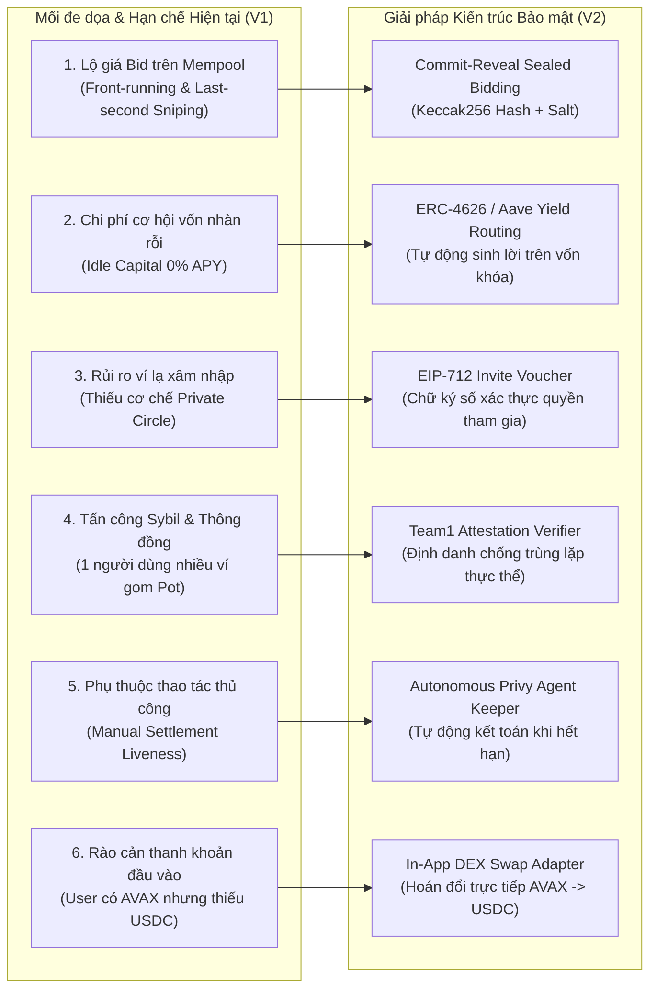

# AVAHUI PROTOCOL — KIẾN TRÚC BẢO MẬT, ĐẶC TẢ KỸ THUẬT NÂNG CAO & LỘ TRÌNH MỞ RỘNG (V2 SPECIFICATION)

**Tài liệu:** Đặc tả Kỹ thuật, Phân tích Mô hình Mối đe dọa (Threat Model) & Thiết kế Mở rộng Giao thức  
**Mạng lưới mục tiêu:** Avalanche C-Chain / Fuji Testnet (`chainId: 43113`)  
**Phạm vi:** Smart Contracts (`Solidity 0.8.24`), Indexer & Backend (`NestJS + Prisma + PostgreSQL`), Web3 Client (`Next.js 14 + Viem`)

---

## MỤC LỤC
1. [Tổng quan Hiện trạng Hệ thống (Baseline Audit)](#1-tổng-quan-hiện-trạng-hệ-thống-baseline-audit)
2. [Phân tích Lỗ hổng Nghiệp vụ & Mô hình Mối đe dọa (Threat & Gap Analysis)](#2-phân-tích-lỗ-hổng-nghiệp-vụ--mô-hình-mối-đe-dọa-threat--gap-analysis)
3. [Đặc tả Kỹ thuật 4 Module Nâng cao Trọng tâm](#3-đặc-tả-kỹ-thuật-4-module-nâng-cao-trọng-tâm)
   - [3.1. Module A: Đấu giá Kín Mật mã học — Sealed-Bid (Commit-Reveal)](#31-module-a-đấu-giá-kín-mật-mã-học--sealed-bid-commit-reveal)
   - [3.2. Module B: Tối ưu Vốn Nhàn rỗi — Yield on Undisbursed Pool (ERC-4626 / Lending)](#32-module-b-tối-ưu-vốn-nhàn-rỗi--yield-on-undisbursed-pool-erc-4626--lending)
   - [3.3. Module C: Dây hụi Riêng tư & Vé mời Chữ ký số — Invite by Link (EIP-712)](#33-module-c-dây-hụi-riêng-tư--vé-mời-chữ-ký-số--invite-by-link-eip-712)
   - [3.4. Module D: Chống Tấn công Sybil — Team1 Attestation Verifier](#34-module-d-chống-tấn-công-sybil--team1-attestation-verifier)
4. [Đánh giá & Sàng lọc Hệ sinh thái Công cụ Mở rộng](#4-đánh-giá--sàng-lọc-hệ-sinh-thái-công-cụ-mở-rộng)
   - [4.1. Các Công nghệ Khuyến nghị Tích hợp (High-Impact)](#41-các-công-nghệ-khuyến-nghị-tích-hợp-high-impact)
   - [4.2. Các Công nghệ Loại bỏ & Lý giải Bảo mật (Rejected Scope)](#42-các-công-nghệ-loại-bỏ--lý-giải-bảo-mật-rejected-scope)
5. [Bất biến Kế toán & Tiêu chuẩn Bảo mật Smart Contract (Security Invariants)](#5-bất-biến-kế-toán--tiêu-chuẩn-bảo-mật-smart-contract-security-invariants)
6. [Kế hoạch Triển khai Chi tiết Theo Từng Tầng (Implementation Blueprint)](#6-kế-hoạch-triển-khai-chi-tiết-theo-từng-tầng-implementation-blueprint)

---

## 1. TỔNG QUAN HIỆN TRẠNG HỆ THỐNG (BASELINE AUDIT)

Hệ thống **AvaHui** hiện tại đã hoàn thiện 100% luồng nghiệp vụ cốt lõi (Core ROSCA Lifecycle) qua 5 giai đoạn tích hợp, bao gồm:

### 1.1. Những thành phần đã hoàn thiện (Implemented Baseline)

| Tầng Kiến trúc | Thành phần Đã Có | Chi tiết Kỹ thuật Hiện tại |
| :--- | :--- | :--- |
| **Smart Contracts (`apps/contracts`)** | `AvaHuiFactory.sol` | Khởi tạo từng dây hụi độc lập (Isolated Escrow Pattern), lưu trữ danh sách địa chỉ hợp đồng và ánh xạ `metadataId`. |
| **Smart Contracts (`apps/contracts`)** | `AvaHuiCircle.sol` | Hỗ trợ 2 chế độ: `FIXED` (nhận pot theo thứ tự slot) và `BIDDING` (đấu giá chiết khấu mở). Khóa thế chấp `mUSDC`, tự động trích thế chấp (**Auto-Slash**) khi thành viên quá hạn đóng tiền, chia đều `totalDiscountPool` cuối kỳ. |
| **Smart Contracts (`apps/contracts`)** | `SecurityLib.sol` & `MockUSDC.sol` | Chống Reentrancy, kiểm tra số dư/allowance, token chuẩn 6 decimals có hàm `faucet`. |
| **Backend & Indexer (`apps/api`)** | `BlockchainIndexerService` | Worker quét RPC Avalanche Fuji theo chu kỳ 3.000ms, giải mã 10 sự kiện on-chain, xử lý bất biến (idempotent) qua khóa duy nhất `UNIQUE(chain_id, tx_hash, log_index)`. |
| **Database (`PostgreSQL 17`)** | Schema 13 bảng, 6 Enums | Lưu trữ đầy đủ `circles`, `circle_members`, `collaterals`, `rounds`, `contributions`, `bids`, `payouts`, `blockchain_transactions`, `blockchain_events`, `notifications`. |
| **Frontend (`apps/web`)** | Next.js 14 + Viem + React Query | Giao diện điều khiển `SmartActionBox`, tạo dây hụi `CreateCircleView`, tự động kiểm tra/approve `mUSDC`, theo dõi tiến trình ký 4 bước và đồng bộ real-time với Backend. |

---

## 2. PHÂN TÍCH LỖ HỔNG NGHIỆP VỤ & MÔ HÌNH MỐI ĐE DỌA (THREAT & GAP ANALYSIS)

Mặc dù phiên bản hiện tại vận hành trơn tru mô hình ROSCA cơ bản, khi đặt dưới góc độ **Bảo mật Tài chính Phi tập trung (DeFi Security)** và **Lý thuyết Trò chơi (Game Theory)**, hệ thống còn tồn tại **6 điểm nghẽn kỹ thuật** cần giải quyết:



### Phân tích chi tiết từng vấn đề:
1. **Lộ thông tin trong Đấu giá Mở (Information Asymmetry & Sniping):**
   - Trong `AvaHuiCircle.sol` hiện tại, hàm `submitBid(roundNumber, bidAmount)` truyền thẳng `bidAmount` dưới dạng plaintext lên mạng lưới.
   - Hệ quả: Người đặt giá trước bị lộ mức trần. Các thành viên khác hoặc bot có thể đợi đến những giây cuối cùng trước `biddingDeadline` để đặt mức giá chỉ nhỉnh hơn 1 đơn vị nhỏ (`currentHighestBid + 1`), làm mất tính công bằng của đấu giá hụi truyền thống (vốn là bỏ thăm kín).
2. **Lãng phí Vốn Thế chấp (Zero Capital Efficiency):**
   - Trong một dây hụi $N$ người với mức đóng $C$ và thế chấp $M$, tổng lượng vốn khóa cố định trong hợp đồng tối thiểu là $N \times M$. Khoản tiền này nằm bất động suốt vòng đời dây hụi mà không sinh ra lãi suất.
3. **Thiếu Kiểm soát Truy cập Cấp độ Nhóm (Lack of Cryptographic Access Control):**
   - Bất kỳ địa chỉ ví nào cũng có thể gọi `joinCircle()` khi trạng thái là `RECRUITING`. Chủ dây hụi không thể giới hạn dây hụi cho những người được mời.
4. **Tấn công Sybil Chiếm đoạt Thanh khoản Sớm (Sybil Collusion Attack):**
   - Nếu tỷ lệ thế chấp bằng $1\times$ mức đóng góp hàng kỳ ($M = C$), nhưng quy mô dây hụi là $N = 10$ người (Pot = $10C$), một kẻ tấn công có thể tạo 9 ví ảo để lấp đầy dây hụi cùng 1 nạn nhân thật, hoặc dùng nhiều ví thao túng các vòng đầu rồi cố tình vỡ nợ có chủ đích (strategic default) ở các vòng cuối nếu lợi ích chiếm đoạt lớn hơn phần thế chấp bị phạt.
5. **Phụ thuộc Kích hoạt Thủ công (Liveness Bottleneck):**
   - Hàm `settleRound()` hiện phải chờ một người dùng bấm nút trên giao diện sau khi qua hạn chót. Nếu không ai bấm, vòng hụi bị đình trệ.

---

## 3. ĐẶC TẢ KỸ THUẬT 4 MODULE NÂNG CAO TRỌNG TÂM

### 3.1. Module A: Đấu giá Kín Mật mã học — Sealed-Bid (Commit-Reveal)

#### A. Cơ chế Mật mã học
Thay thế cơ chế đấu giá công khai bằng quy trình **2 pha (Two-Phase Commit-Reveal)** trong mỗi vòng đấu giá:

1. **Pha 1 — Commit Phase (`startTime` $\to$ `commitDeadline`):**
   - Người chơi chọn mức giá chiết khấu `bidAmount` và một chuỗi ngẫu nhiên bí mật `salt` (`bytes32`).
   - Client tính toán mã băm cam kết (Commitment Hash) theo chuẩn miền phân tách (Domain-Separated Hash):
     $$\text{commitment} = \text{keccak256}\big(\text{abi.encodePacked}(\text{address(this)}, \text{roundNumber}, \text{msg.sender}, \text{bidAmount}, \text{salt})\big)$$
   - Người chơi gọi hàm `commitBid(uint8 roundNumber, bytes32 commitment)`. Trên chuỗi chỉ lưu `commitment`, không ai biết giá trị `bidAmount`.

2. **Pha 2 — Reveal Phase (`commitDeadline` $\to$ `biddingDeadline`):**
   - Người chơi gửi giá trị thực và `salt` qua hàm `revealBid(uint8 roundNumber, uint256 bidAmount, bytes32 salt)`.
   - Smart Contract kiểm tra:
     - Tính lại mã băm và đối chiếu với `commitments[roundNumber][msg.sender]`.
     - Kiểm tra điều kiện hợp lệ: `minBid <= bidAmount <= maxBid`.
     - Nếu `bidAmount > round.highestBid`, cập nhật người dẫn đầu vòng hiện tại. Nếu bằng nhau, ưu tiên người có `commitTimestamp` sớm hơn (Deterministic Tie-Breaking).

#### B. Thiết kế Cấu trúc Dữ liệu Smart Contract
```solidity
struct BidCommitment {
    bytes32 commitment;
    uint64 committedAt;
    bool revealed;
    uint256 revealedAmount;
}

// roundNumber => memberAddress => BidCommitment
mapping(uint8 => mapping(address => BidCommitment)) internal _bidCommitments;
```

#### C. Cơ chế Bảo vệ Chống Tấn công Bỏ Mở Thăm (Anti-Withholding / Griefing Protection)
- Nếu hết `biddingDeadline` mà không có bất kỳ ai reveal hợp lệ, hệ thống tự động fallback về người có `slotIndex` nhỏ nhất chưa nhận Pot (đảm bảo vòng hụi không bao giờ bị kẹt).

---

### 3.2. Module B: Tối ưu Vốn Nhàn rỗi — Yield on Undisbursed Pool (ERC-4626 / Lending)

#### A. Kiến trúc Dòng tiền Sinh lời
Toàn bộ số dư `mUSDC` đang nằm chờ trong hợp đồng `AvaHuiCircle` bao gồm:
1. **Quỹ thế chấp cố định (`Locked Collateral Pool`)**: Khóa từ đầu đến cuối dây hụi.
2. **Quỹ đóng góp từng vòng (`Undisbursed Round Contributions`)**: Nằm chờ từ lúc thành viên đóng tiền cho tới thời điểm `settleRound`.

Thay vì để số dư này nằm im trong hợp đồng `AvaHuiCircle`, hợp đồng sẽ chuyển tiếp (route) thanh khoản vào một **Yield Vault chuẩn ERC-4626** (`AvaHuiYieldVault.sol`).

#### B. Công thức Phân bổ Lợi suất & Bảo vệ Vốn Gốc (Principal Safety Invariant)
1. **Gửi vào Vault:** Mỗi khi nhận `collateralAmount` (lúc `joinCircle`) hoặc `contributionAmount` (lúc `contribute`), hợp đồng tự động nạp vào `yieldVault` nếu tính năng Yield được bật.
2. **Giải ngân hàng kỳ:** Khi `settleRound(roundNumber)` chạy, hợp đồng rút đúng `netPayoutAmount` từ `yieldVault` để trả cho người thắng. Phần chiết khấu (`winningBidAmount`) và toàn bộ `collateral` vẫn nằm lại trong `yieldVault` để tiếp tục sinh lãi kép.
3. **Tất toán cuối kỳ (`CircleCompleted`):**
   - Hợp đồng rút toàn bộ `shares` còn lại từ `yieldVault` về lại `AvaHuiCircle`.
   - Mỗi thành viên khi gọi `withdrawCollateral()` sẽ nhận được 3 khoản: Thế chấp gốc còn lại + Thưởng đấu giá (`totalDiscountPool / N`) + Lãi suất DeFi (`totalYieldEarned / N`).

---

### 3.3. Module C: Dây hụi Riêng tư & Vé mời Chữ ký số — Invite by Link (EIP-712)

#### A. Cơ chế Xác thực Không Tốn Gas khi Tạo Lời mời (Stateless Off-chain Invite Voucher)
Để chủ dây hụi (`creator`) có thể mời bạn bè qua đường dẫn URL mà không cần tốn gas gửi giao dịch whitelist từng địa chỉ lên blockchain, hệ thống sử dụng vé mời chữ ký số (`joinCircleWithVoucher`):
- Hỗ trợ cả **Vé mời đích danh (`invitee != address(0)`)** và **Vé mời dùng một lần qua liên kết (`invitee == address(0)` kèm `nonce` duy nhất)**.
- Ngay sau khi dùng, `usedInviteNonces[nonce] = true`.

---

### 3.4. Module D: Chống Tấn công Sybil — Team1 Attestation Verifier

#### A. Kiến trúc Xác thực Thực thể Duy nhất (Unique Human / Identity Nullifier)
Để ngăn chặn kịch bản 1 cá nhân tạo nhiều ví tham gia cùng một dây hụi nhằm thao túng đấu giá hoặc thông đồng vỡ nợ:
- **Lớp 1 — Chữ ký Attestation hợp lệ:** Chỉ cho phép ví có chứng thực được ký bởi `Team1AttestationVerifier`.
- **Lớp 2 — Chống Trùng lặp Thực thể (`Identity Nullifier Check`):** Lưu `mapping(bytes32 => bool) public hasIdentityJoined;` trong từng hợp đồng `AvaHuiCircle`. Dù một người dùng tạo nhiều ví khác nhau nhưng cùng liên kết tới một định danh `identityHash`, họ chỉ có thể tham gia tối đa **1 vị trí (1 slot)** trong cùng một dây hụi.
- **Lớp 3 — Cấp độ uy tín (`trustTier`):** Phân tầng uy tín thành viên (`1: Basic`, `2: Verified Team1 Member`, `3: High Reputation Builder`).

---

## 4. ĐÁNH GIÁ & SÀNG LỌC HỆ SINH THÁI CÔNG CỤ MỞ RỘNG

### 4.1. Các Công nghệ Khuyến nghị Tích hợp (High-Impact)

| Công nghệ / Module | Đánh giá Mức độ Phù hợp | Thiết kế Tích hợp Cụ thể vào AvaHui |
| :--- | :---: | :--- |
| **1. Autonomous Keeper Service** | **Rất Cao (Critical Automation)** | **Autonomous Settlement Keeper:** Triển khai `AutonomousKeeperService` trong NestJS tự động kiểm tra các vòng hụi đã qua hạn và kích hoạt kết toán tự động. |
| **2. On-Chain Swap Quote & Execution (`AVAX` $\to$ `mUSDC`)** | **Cao (UX & Liquidity Onboarding)** | **1-Click Collateral Swap (`MockAvaxUsdcSwap.sol`):** Tích hợp nút *"Quick Swap AVAX -> mUSDC"* ngay trên `EmbeddedWalletBar` để người dùng đổi nhanh sang `mUSDC`. |
| **3. Rate-Limited Faucet với Cooldown** | **Trung bình - Cao (Anti-Drain Security)** | **Protected Testnet Faucet:** Bổ sung cơ chế giới hạn tần suất nhận token (Cooldown per address) trên API và UI. |

---

## 5. BẤT BIẾN KẾ TOÁN & TIÊU CHUẨN BẢO MẬT SMART CONTRACT (SECURITY INVARIANTS)

1. **Bất biến Bảo toàn Tổng Quỹ (Conservation of Value Invariant):**
   $$\text{Balance}_{\text{Contract}}(t) + \text{Assets}_{\text{YieldVault}}(t) \ge \sum_{i=1}^{N} \text{LockedCollateral}_i(t) + \text{DiscountPool}(t) + \text{CurrentRoundPot}(t)$$
2. **Bất biến Độc lập Vòng Đấu giá (Single-Win Invariant):** Mỗi thành viên chỉ có thể nhận Pot đúng 1 lần duy nhất trong suốt $N$ vòng.
3. **Bất biến Anti-MEV Commit-Reveal:** Trong chế độ `SEALED_BIDDING`, mọi lệnh gọi `revealBid()` đều phải khớp tuyệt đối với `commitment` đã gửi trước `commitDeadline`.
4. **Bất biến Chống Trùng lặp Thực thể (Sybil Nullifier Uniqueness):** Không thể có hai vị trí thành viên trong cùng một dây hụi chia sẻ chung một `identityHash`.
5. **Bất biến Chống Tấn công Tái nhập (CEI & Non-Reentrant):** Mọi hàm thay đổi số dư đều áp dụng khóa `nonReentrant` và cập nhật trạng thái trước khi chuyển token.

